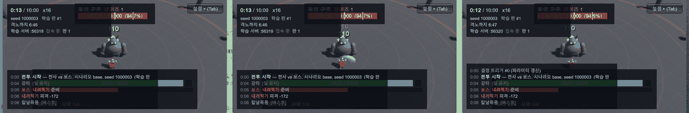
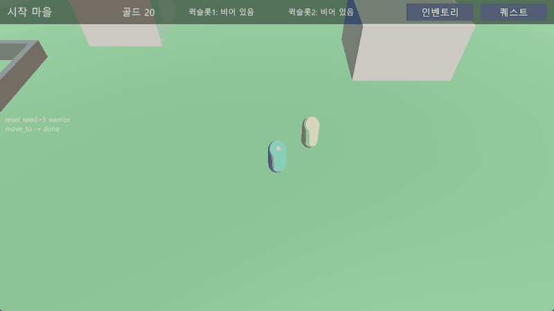
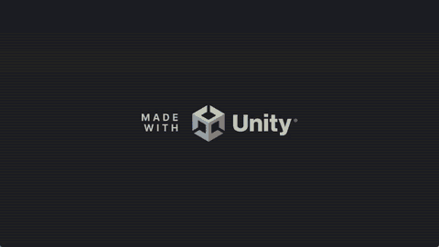

# BT-QA — Reinforcement learning for game balance QA, decoupled from the game

**Designers own the behavior tree. RL learns only the weights they declare — and hands them back.**

The game exposes its combat behavior tree (BT) and declares which block weights may be learned. A learning platform
(CMA-ES, IMPALA) tunes only those weights per player persona, over a plain TCP protocol, on CPU.
The same contract works for a Unity game and a Python simulator, and the learned weights drive the real game's combat
when an agent plays it from the first village.



*Unity build, same boss fight and same seed, replayed side by side (16×): hand-tuned defaults · CMA-ES · IMPALA policy.*

---

## Why this direction

I have worked on reinforcement learning for game balance QA for a long time. Two problems kept coming back:

- **RL is welded to the game.** Observation and action spaces are game-specific, so every game — often every patch —
  means rebuilding the agent. The result is a black-box policy that designers cannot read or adjust.
- **LLM agents are a poor fit for combat.** Letting the model make every decision costs a call (latency and money) per
  decision, while a combat BT decides every 0.3 s. Fine-tuning the model costs time and GPUs instead.

This project tries a different split:

| Decision | Who makes it | How often |
|---|---|---|
| Behavior structure (blocks, need functions) | Designers, in the game's BT | Design time |
| Block weights `w` in `score = N(situation) × w` | **RL — the only thing it learns** | Once per fight, or at trigger points (boss HP 75/50/25 %) |
| Moment-to-moment combat actions | The BT itself | Every 0.3 s |
| Non-combat play (talk, shop, travel) | An LLM pilot (optional) — down to a distilled 1.5B model on CPU | Rarely |

Small, declared learning targets keep the policy interpretable (a handful of named weights), cheap to train, and
reusable across games: the learning side never sees skills, stats or game code — only the declared parameters.

## How it works

```
┌──────────── Game (Unity or Python) ────────────┐                 ┌──────────── Learning platform ────────────┐
│ combat sim + behavior tree (deterministic, seed)│                 │ balance_qa (PyTorch CPU)                   │
│ IEpisodeHost: declare() / run_episode()         │ ◀── TCP JSON ──▶ │   learnable space = declared block weights │
│ BT-QA Game SDK: server, validation, triggers    │    Lines 1.3     │   personas = non-weight settings + rewards │
└─────────────────────────────────────────────────┘                 │   CMA-ES · IMPALA (V-trace, remote actors) │
                                                                    └────────────────────────────────────────────┘
```

- **Weights-only, enforced.** The game declares `blocks: [{name, weight}]`. The SDK refuses to start if anything else is
  marked learnable, and the learner rejects any other learning target. Non-weight values (potion threshold, resource
  reserve…) stay at the designers' defaults or come from a persona.
- **Personas** (aggressive / stable / efficient) set need-function thresholds and reward coefficients
  (`R = −minutes − λ_death·deaths − λ_consumable·items − penalty·[fail]`); each gets its own optimal weights.
- **Two learners on one interface:** CMA-ES picks static weights per fight; IMPALA (Beta actor-critic, V-trace) changes
  weights at trigger points from the fight state. Actors are separate processes, one per game instance, so the same
  code can run local or remote actors.
- **Determinism is part of the contract:** same class, scenario, seed, params and trigger replies → byte-identical
  result. A conformance checker verifies this, along with the message formats, error codes and trigger round-trips.
- **Play mode:** the game can also be played from the start (village → field → boss). Non-combat actions come from
  an LLM pilot or a script; when a fight starts, the learned weights take over, and the outcome matches the
  balance-mode episode exactly.



*Play mode from the first village: tutorial quests by a scripted pilot, the wolf king fought by the IMPALA-tuned BT.*

## Results

Unity build `qa_arena 0.7.0`, persona *stable*, 200–300 evaluation episodes on held-out seeds, mean [95 % CI].
Only the three block weights are learned.

| Class / fight | Hand-tuned defaults | CMA-ES (3,000 episodes) | IMPALA |
|---|---|---|---|
| Warrior vs arena boss | clear 62 % · deaths 1.01 | clear **100 %** · deaths 0.52 · 362 s | clear 99 % · deaths 0.49 · 405 s (8,000 ep.) |
| Mage vs arena boss | clear 62 % · deaths 2.75 | clear **89 %** · deaths 2.06 · 434 s | — |
| Warrior vs wolf king (field boss) | clear 60 % · deaths 2.06 | clear **100 %** · deaths 1.26 · 351 s | clear 99 % · deaths 1.22 · 341 s (3,000 ep.) |

- **Cost:** one episode takes 1–2 ms in the headless Unity build. The full measurement above — baselines for 3 classes ×
  2 personas, two CMA-ES runs and one IMPALA run — took **about 20 seconds** on CPU with 4 game instances.
- **Same seed, different outcome:** the GIF at the top is evaluation seed 1000003. The hand-tuned BT times out at
  10:00 with the boss at 0.2 %; both learned BTs clear it.

### What the platform surfaced along the way

The measurement history across builds (see `docs/STATUS.md`, in Korean) is where the tool earned its keep:

- **Revive used as a heal.** In build 0.3.0 the learned weights cleared 94–98 % of fights but died 2–3 times per run.
  Dying and reviving was cheaper than defending. This led to revive and regen changes in the game (0.4.0).
- **A persona that learned to give up.** Without a failure penalty, the *stable* warrior learned to survive until the
  timer ran out (0 % clears). We added an explicit failure term to the reward. It is a deliberate deviation from the
  original proposal and is documented as such.
- **A class that died too much.** Hand-tuned warrior cleared 55 % with about 3 deaths per run, and even optimized weights
  still died about twice per run. That pointed to the class itself, so we sent a balance request to the game side. The
  armor change in 0.5.0 brought hand-tuned to 62 % with 1.01 deaths per run, about a third of before.
- **Open:** hand-tuned mage reportedly clears 0 % against the wolf king. The next step is telling a parameter problem
  from a boss-design problem.

## A 1.5B local model as the non-combat player

The LLM pilot does not need a large model. A Claude Code session played the tutorial as the **teacher** (through
`relay`, no API calls), and its decisions were distilled into **Qwen2.5-1.5B-Instruct** with LoRA on one RTX 3060.
The student is stateless: it sees only the current observation and the result of its last action, and returns one JSON
action. It runs as a 4-bit GGUF (941 MB) through Ollama, **CPU only**.



*Distilled model `r8`, CPU inference, waiting time between calls cut out (8 min 26 s of play → about 25 s here). The
"QA player" panel shows what the model read from its input and why it chose each action. Combat is the learned BT.*

| Model | Tutorial quests (of 5, seeds 1–5) | Notes |
|---|---|---|
| Qwen2.5-1.5B, no training | 0 | ignores the quest, repeats `talk` in an open dialog |
| + SFT on 7 teacher games | 1 | invents progress ("collected 3 herbs") instead of reading it |
| + situation-reading prefix, DAgger ×3, input cues | **5** | 41–43 actions, 0 % format errors, ~8 s per call on CPU |
| + DPO / RFT (GRPO, the game as grader) | 0–3 | both made it worse at this data size; RFT also reward-hacked a repeated button click |

- **What mattered most was not more data** but cues the model only has to *copy* from its input before deciding:
  quest progress, whether the target is in this zone, distance (near/far), which button matches the objective text,
  and the id of each button in an open window. The decision becomes a copying problem a small model can do.
- **DAgger** found exactly where the student got stuck; the teacher labeled only those steps (the student was right on
  93–95 % of its own steps).
- **The inference device is part of the evaluation.** The same weights complete 5/5 on CPU but 1/5 on GPU: numeric
  differences flip a near-tie early, and the run falls into a loop. One more DAgger round with the GPU student raised
  that to 3/5.
- The SDK keeps the pipeline game-agnostic. Game-specific pieces (the situation prefix, the RFT reward, loadout setup)
  are plain functions in `play_agent`, passed to the SDK commands by name (`--prep play_agent.distill_prep:prep_sample`).
  Model weights are never committed; the training data is (`distill_data/`). Details: [`docs/DISTILL.md`](docs/DISTILL.md) (Korean).

## Repository layout

```
balance_qa/     learning platform: protocol client, CMA-ES / ES / IMPALA (PyTorch CPU), rewards, evaluation, reports
btqa_sdk/       BT-QA SDK — separate repository, cloned here and installed editable (not committed)
play_agent/     play-mode client (on top of the SDK's btqa_play): loadout from learned results, numpy policy runner, optional LLM pilot (bring your own LLM: Claude API, or any OpenAI-compatible server incl. local Ollama / LM Studio — see docs/LLM_SETUP.md), QaArena hooks for distillation (prep, reward)
distill_data/   distillation data: teacher and DAgger records, datasets, training logs (no model files)
game_sim/       Python reference game (BT, combat sim) — test double and reference implementation
unity_game/     QaArena, the Unity test game (Unity 6000.0); SDK as embedded package Packages/com.btqa.game
qa_specs/       personas
experiments/    hypothesis experiments E0–E7
run/            one-click run scripts (also registered as PyCharm run configurations)
docs/           protocol (contract), play protocol, architecture, status — mostly Korean
```

The SDK (Python `btqa_game` game side + `btqa_play` LLM play client + optional `btqa_distill` LoRA training/export,
Unity package, protocols) is maintained separately at
**[jk96491/btqa_sdk](https://github.com/jk96491/btqa_sdk)**. Python uses it directly (editable install, see Quick start);
the Unity package and the protocol documents are vendored copies (`run/run_sync_sdk.py`), and a test checks they match.

## Quick start

Requirements: Python 3.8+, `numpy`, `torch` (CPU). The Unity build is optional — the Python game runs everything.

Install guide (Korean, with troubleshooting): [`docs/INSTALL.md`](docs/INSTALL.md).

```bash
pip install -r requirements.txt
python run/run_setup_sdk.py                                # clones btqa_sdk into ./btqa_sdk, editable install, checks
python -m unittest discover -s tests -t .                  # tests
python -m balance_qa check-game                            # protocol conformance (Python game)
python -m balance_qa --workers 4 optimize --cls warrior --persona stable --budget 3000          # CMA-ES
python -m balance_qa --workers 4 impala   --cls warrior --persona stable --budget 8000 \
    --init-params reports/<run_id>/params.json                                                  # IMPALA
```

With the Unity build (`unity_game/Build/QaArena.exe`, built with `unity_game/QaTools~/build.ps1`):

```bash
python run/run_full_cycle.py      # conformance → baseline → CMA-ES → IMPALA → report (set GAME_CMD = UNITY)
python run/run_watch.py           # replay saved results side by side in Unity windows (top GIF)
python run/run_watch_play.py      # play mode from the village, combat by the learned BT (second GIF)
python run/run_play_local.py      # a local LLM (Ollama, CPU) plays from the village — set MODEL to a distilled model
python run/run_record_play.py     # same, recorded to mp4 / gif with the waiting time cut out (Windows)
```

Distillation (teacher records → dataset → LoRA → GGUF → Ollama → evaluation) is in [`docs/DISTILL.md`](docs/DISTILL.md) §3;
training needs a separate Python ≥ 3.10 venv with CUDA PyTorch (`btqa_sdk/docs/DISTILL_SDK.md`).

To connect your own game, implement `IEpisodeHost` with the SDK and pass `python -m btqa_game check --game host:port`.

## Limitations

- **Toy environment.** 1-vs-1 boss fights on a one-dimensional distance axis, three classes. Read the numbers as trends
  and relative sizes, not as claims about a real game.
- **Integration prerequisite.** The game must run its combat headless, deterministically and fast (milliseconds per
  episode). Separating combat logic from rendering is the main cost of adopting this. In QaArena, the game-specific
  glue is one ~100-line class.
- **Few learning targets by design.** With three weights a grid search is a fair baseline, and IMPALA's trigger-time
  policy is not yet clearly better than CMA-ES's static weights here. Showing where state-dependent weights matter
  (experiment E7) is open work. Scaling all weights by the same factor doesn't change behavior; this redundancy is left
  as is.
- **LLM play:** each user plugs in their own LLM (`docs/LLM_SETUP.md`). A Claude Code session (via `relay`, no API
  calls) and the distilled 1.5B model (Ollama, CPU) both complete the 5 tutorial quests. The distilled model covers only
  this tutorial, was trained on one class (warrior), and is fragile: the same weights fail on GPU, and DPO/RFT on top of
  it made it worse. The Claude API backend is tested against fakes but not run live (no API spend).
- **Not yet done:** full-scale runs of
  experiments E1–E7, and a cost comparison against an LLM-only player.

## Background

This continues my article series on applying RL to games,
[「実録・ゲーム強化学習適用記」 (Qiita, Japanese)](https://qiita.com/raptorjung/items/0be8fb02181c83735bf5).
The previous part moved execution to rule-based behavior and kept RL for judgment. It ended with an open question: how
to fine-tune fixed rule-based actions without losing stability. This project answers it, and also removes RL's
dependence on any single game.

*Code identifiers and this README are in English. Internal docs and code comments are in Korean
(Korean overview: [docs/README.ko.md](docs/README.ko.md)).*
